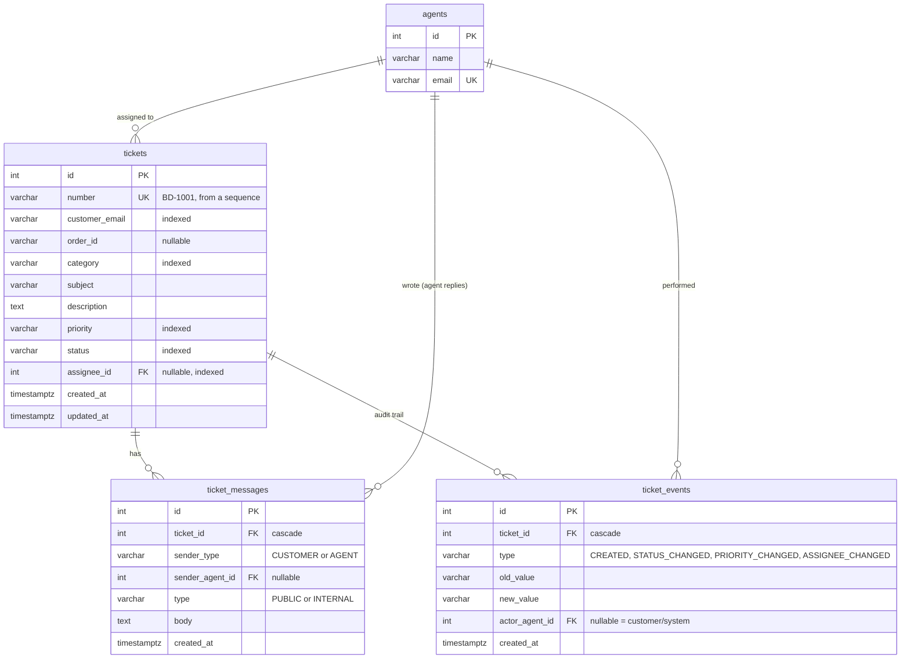

# Badi eSIM Support Ticketing

A small support ticketing module for Badi eSIM. Customers open and follow a support case; support agents filter, reply, add internal notes, assign and resolve tickets. Customer-visible replies appear on both sides in real time, and every important change is recorded in an audit trail.

**Stack:** FastAPI · SQLModel (SQLAlchemy 2) · PostgreSQL 16 · Alembic · React 19 + TypeScript (Vite) · TanStack Query · WebSockets · pytest · Docker

---

## Quick start (Docker, one command)

Requires Docker Desktop.

```bash
docker compose up --build
```

Open **http://localhost:8080**. On first start the API container runs the migrations and loads demo data. Restarting the containers keeps your data.

- API docs (Swagger): http://localhost:8000/docs
- To reset the demo data: `docker compose exec api python -m app.seed`
- To run the tests in Docker: `docker compose exec api pytest`

## Local development setup (without Docker for the app)

Requires Python 3.12+, Node.js 20.19+ or 22.12+ and Docker (for PostgreSQL only).

```bash
# 1. Database
docker compose up -d db

# 2. Backend (terminal 1)
cd backend
python -m venv .venv
.venv\Scripts\activate            # Windows
# source .venv/bin/activate       # macOS / Linux
pip install -r requirements.txt
cp .env.example .env              # Windows: copy .env.example .env
alembic upgrade head              # create the tables
python -m app.seed                # demo data (resets tickets!)
uvicorn app.main:app --reload     # http://localhost:8000/docs

# 3. Frontend (terminal 2)
cd frontend
npm install
npm run dev                       # http://localhost:5173
```

In development, Vite forwards `/api` and `/ws` to the backend on port 8000. In Docker, nginx does the same job. Either way, the browser only ever talks to one origin.

> Don't run the Docker `api` service and a local `uvicorn` at the same time: both use port 8000.

### Running the tests

```bash
cd backend
pytest
```

The tests use a real PostgreSQL database named `badi_support_test`. It is created automatically and kept separate from the demo data. See [Testing](#testing).

## Trying it out

There is no login screen (see [Assumptions](#assumptions)). Use the **"Viewing as"** switcher in the top bar:

| Identity | What you can do |
|---|---|
| Agent: Anas / Maria / Joel | See all tickets, filter and search, reply, add internal notes, change status/priority/assignee, see audit history |
| Customer (`customer@example.com`) | See only your own tickets (BD-1001, BD-1003), open new ones, reply |

**To see real-time updates:** open BD-1001 as *Agent: Anas* in a normal window and as *Customer* in a private window. Replies and status changes appear in the other window without a refresh. Internal notes appear only on the agent side.

Demo data includes the exact example from the brief (BD-1001, *eSIM installed but no internet*, order ORD-10293, escalated to the provider), plus tickets in other states: new and unassigned, waiting for the customer, urgent, and resolved.

---

## Architecture

```
React (Vite)  ── REST /api ──►  FastAPI  ──►  SQLModel  ──►  PostgreSQL
     ▲                            │
     └──── WebSocket /ws ◄────────┘  (signals: "message.created", "ticket.updated")
```

```
backend/
  app/
    models.py            tables + enums (the data model)
    schemas.py           API request/response shapes and validation rules
    deps.py              who is calling (agent or customer) + DB session
    services/tickets.py  business rules: numbering, workflow, audit trail, visibility
    routers/             thin HTTP layer: tickets, agents + mock orders, websocket
    realtime.py          per-ticket WebSocket rooms
    main.py              app setup, CORS, readable validation errors
    seed.py              demo data
  alembic/versions/      database migrations
  tests/                 pytest suite (real PostgreSQL)
frontend/
  src/
    api.ts               the only module that calls the backend; normalises errors
    identity.tsx         demo identity (agent/customer), sent as headers
    useTicketLive.ts     WebSocket subscription with auto-reconnect
    pages/               ticket list, ticket detail, new ticket
    components.tsx       badges, loading/empty/error states, identity switcher
```

**Routers vs services.** Routers deal only with HTTP: parsing input, status codes and responses. The rules live in `services/tickets.py`, so they are easy to test and are reused by the real-time layer.

## Data model



Key decisions:

- **Three tables for three concerns.** `tickets` holds the *current* state, `ticket_messages` the conversation, and `ticket_events` the *history*. Events are only ever inserted, never updated.
- **Readable ticket numbers come from a PostgreSQL sequence** (`'BD-' || nextval('ticket_number_seq')`, starting at 1001) set as the column's server default. Two tickets created at the same moment can never get the same number, which isn't true of "read the max number and add 1" in Python. Alembic cannot autogenerate sequences, so the `CREATE/DROP SEQUENCE` lines in the migration were added by hand.
- **Internal notes are messages with `type = INTERNAL`,** not a separate table. That keeps one ordered timeline per ticket, and visibility is filtered on the server.
- **Enums are stored as `VARCHAR` and validated in Python** (`native_enum=False`) rather than as PostgreSQL `ENUM` types. Adding a category or status is a code change with no `ALTER TYPE` migration. The trade-off is that the database itself does not reject unknown values; the API does.
- **The description is the customer's opening message.** It is stored on the ticket and shown at the top of the thread, not duplicated in `ticket_messages`.
- **Indexes** cover every list filter (status, priority, category, assignee, customer email), plus `(ticket_id, created_at)` for loading a thread or history in order.
- **Timestamps are `timestamptz`** (stored in UTC, shown in the viewer's local time).
- **Customers are identified by email** on the ticket. There is no customer table yet (see Assumptions).

## API

Full interactive documentation lives at `/docs`. Every request identifies the caller with headers (see [Assumptions](#assumptions)):

```
Agent:     X-Role: agent      X-Agent-Id: 1
Customer:  X-Role: customer   X-Customer-Email: customer@example.com
```

| Method | Path | Who | Purpose |
|---|---|---|---|
| `POST` | `/tickets` | both | Create a ticket. It always starts `OPEN` and gets a `BD-` number. Customers can only open tickets for their own email. |
| `GET` | `/tickets` | both | List, newest activity first. Filters: `status`, `priority`, `category`, `assignee_id`, `unassigned=true`, `q` (search number/subject/email/order), `limit` (≤100), `offset`. Customers only see their own. |
| `GET` | `/tickets/{id}` | both | Ticket + messages + audit events. Customers get public messages only and no events. |
| `PATCH` | `/tickets/{id}` | agent | Change `status`, `priority` and/or `assignee_id` (`null` = unassign). Only sent fields change; each real change writes an audit event. |
| `POST` | `/tickets/{id}/messages` | both | Add a reply (`type: PUBLIC`) or an internal note (`type: INTERNAL`, agents only). |
| `GET` | `/agents` | public | Agents, for the assignee dropdown and the demo identity picker. |
| `GET` | `/mock/orders/{order_id}` | public | Mock order summary (ORD-10293, ORD-10310, ORD-10342). |
| `WS` | `/ws/tickets/{id}?role=…` | both | Real-time signals for one ticket. |

### Validation and errors

- Request bodies reject unknown fields (`"priorty"` is reported, not silently ignored). Strings are trimmed before length checks, emails are validated, and order IDs are upper-cased.
- Every error has a consistent JSON shape, and validation errors are reworded to be readable by end users:

```json
{ "detail": "Validation failed",
  "errors": [ { "field": "description", "message": "Must be at least 10 characters" } ] }
```

| Code | When |
|---|---|
| 401 | Missing or unknown identity headers |
| 403 | Customer tries an agent-only action (PATCH, internal note, ticket for another email) |
| 404 | Ticket doesn't exist, **or belongs to another customer**. Using 404 instead of 403 avoids revealing which ticket IDs exist. |
| 409 | Adding a message to a `CLOSED` ticket |
| 422 | Validation errors, including assigning to an agent that doesn't exist |

## Ticket workflow and audit trail

Statuses: `OPEN → IN_PROGRESS → WAITING_FOR_CUSTOMER / WAITING_FOR_PROVIDER → RESOLVED → CLOSED`

- New tickets start `OPEN` and unassigned, with a `CREATED` event.
- Agents may set any status. The UI is the place for guidance; the API does not hard-block transitions, because real support work needs flexibility, such as reopening a closed ticket.
- **A customer reply on a `WAITING_FOR_CUSTOMER` or `RESOLVED` ticket automatically moves it back to `IN_PROGRESS`.** The change is audited with no agent as actor (i.e. the system did it).
- **`CLOSED` tickets accept no new messages** (409) until an agent changes the status.
- Status, priority and assignee changes each write a `ticket_events` row with old value, new value, actor and time. **The event is saved in the same database transaction as the change itself,** so the history can never miss an update or record one that didn't happen. Changes to the same value create no event.

## Real-time updates

Each open ticket screen connects to `/ws/tickets/{id}` and joins that ticket's "room". When a message is added or the ticket changes, the API sends the room a small **signal**, e.g. `{"type": "message.created", "ticket_id": 1}`. The browser then re-fetches the ticket over REST (TanStack Query invalidation).

- **Why signals instead of pushing the data:** the REST endpoint already applies the visibility rules, so there is exactly one place that decides what a customer may see.
- **Internal notes are signalled to agents only,** so customers don't even learn that a note was added.
- The WebSocket checks the same access rules as `GET /tickets/{id}` when connecting (customers only for their own tickets).
- The client reconnects automatically with exponential back-off (1s → 10s) and re-fetches on reconnect, so nothing is missed while offline. A "Live" indicator shows the connection state.
- Endpoints are synchronous (simpler DB code). `anyio.from_thread.run` hands the broadcast from FastAPI's worker thread back to the event loop.

## Frontend

- **Ticket list:** search (debounced), status/priority/category/assignee filters (including *Assigned to me* and *Unassigned*), pagination. Filters live in the URL, so they survive a refresh and can be shared.
- **Ticket detail:** conversation thread (customer, agent and internal notes visually distinct), reply composer with a *Reply to customer / Internal note* toggle (the composer turns yellow in note mode, to prevent accidental public replies), status/priority/assignee controls with *Assign to me*, audit history, and a read-only order summary from the mock endpoint.
- **Customer view:** the same screens without the agent controls, plus a hint about what is expected ("Our support team is waiting for your reply").
- **States:** every data view has loading, empty and error states (with *Try again*). Form errors are shown next to the field they belong to.
- **TanStack Query** manages caching, loading/error states and re-fetching. The current identity is part of every cache key, so switching from agent to customer can never show cached agent-only data.
- Responsive down to phone width.

## Testing

`backend/tests/test_tickets.py`: 12 tests against real PostgreSQL. Each test run first migrates the test database down to empty and back up, so the migrations are tested too. Tables are truncated before each test.

| Area | Tests |
|---|---|
| Required by the brief | Creating a ticket generates `BD-1001`, `BD-1002`… and starts `OPEN`. Changing status creates the expected audit entry. |
| Audit | Priority and assignment changes are audited, unassigning is audited, and repeating a value creates no event. |
| Permissions | Customers never see internal notes or history, only their own tickets, and cannot PATCH or add internal notes. |
| Workflow | A customer reply reopens a waiting ticket. Closed tickets reject messages. |
| Filters | Category, priority, assignee, unassigned and search. |
| Errors | Readable field errors; 404 / 422 / 401 cases. |
| Real time | Agents receive signals for internal notes, customers don't; status changes reach the customer. |

Running a test DB is slightly slower than SQLite, but the app relies on PostgreSQL-specific behaviour (sequences, `ILIKE`, `timestamptz`), so SQLite tests could pass while production fails.

## Assumptions

- **No real authentication.** The caller's identity comes from `X-Role` / `X-Agent-Id` / `X-Customer-Email` headers (query parameters for the WebSocket, since browsers can't set headers there). **This is not security:** anyone can send any header. It lets the API enforce role rules now. Real auth (e.g. JWT/session) would replace only `get_actor()` in `deps.py`, and no endpoint would change.
- Customers are identified by email; the brief captures an email, not an account. A `customers` table could be added when accounts exist.
- Agents are seeded. There is no agent management UI.
- Orders come from a mock endpoint; no eSIM provider integration.
- Agents may move a ticket to any status (see Workflow).

## Trade-offs

| Choice | Benefit | Cost |
|---|---|---|
| In-memory WebSocket rooms | Simple, no extra infrastructure | Only works with **one** API process. Scaling out needs Redis pub/sub or PostgreSQL `LISTEN/NOTIFY`. |
| Signal + re-fetch instead of pushing data | One place enforces visibility; simple client | One extra GET per update (fine at support-desk volumes) |
| VARCHAR enums | New categories/statuses need no migration | DB doesn't enforce allowed values; the API does |
| Sync endpoints + threadpool | Simple, familiar SQLAlchemy code | Lower ceiling than fully async DB access |
| Offset pagination | Simple, supports page numbers | Slower on very large tables than cursor pagination |
| Real PostgreSQL in tests | Tests what production runs | Tests need a PostgreSQL server |

## What I would improve with more time

1. **Real authentication and authorization** (JWT or sessions, agent roles such as admin/agent), plus customer accounts linked to Badi orders.
2. **Notifications:** email or push to the customer when an agent replies, and to the assignee when a customer replies.
3. **SLA / overdue indicators:** first-response and resolution timers per priority, highlighted in the queue.
4. **Attachments:** screenshots of eSIM settings are common in this domain (object storage + virus scanning).
5. **Auto-close:** move `RESOLVED` tickets to `CLOSED` after N days without a customer reply (scheduled job).
6. **Scaling real time** with PostgreSQL `LISTEN/NOTIFY` or Redis so several API instances can run, and live updates on the ticket list too.
7. **Explicit status transition rules,** if the support team wants them enforced.
8. **Frontend tests** (React Testing Library / Playwright), plus CI running backend tests on every push.
9. Optimistic UI for sending messages, cursor pagination, and full-text search (PostgreSQL `tsvector`).
10. A customer-facing React Native / Expo screen.

## AI usage

This project was built with an AI coding assistant (Claude), step by step: requirements and data model first, then the database, API, frontend with real time, tests, Docker and this README. Each step was reviewed and run locally before moving on. The **complete AI conversation transcript is included** with this submission, as the brief requires.
